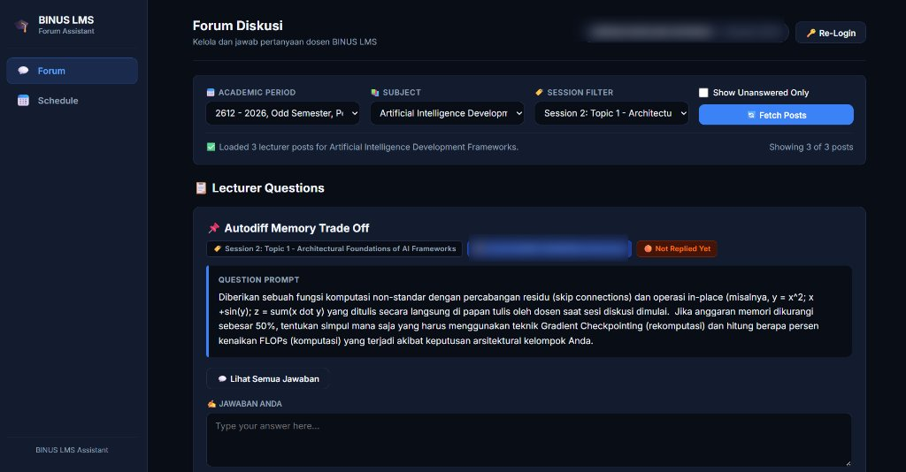
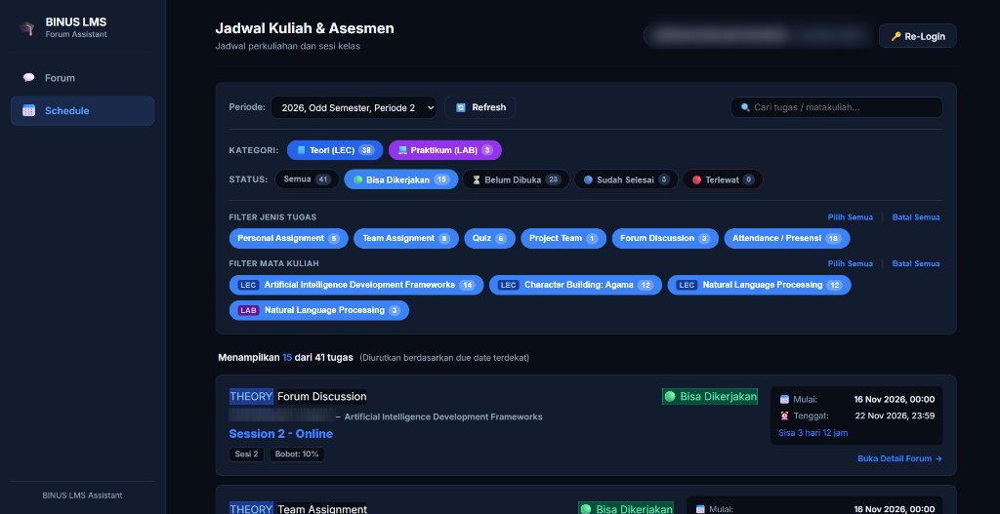
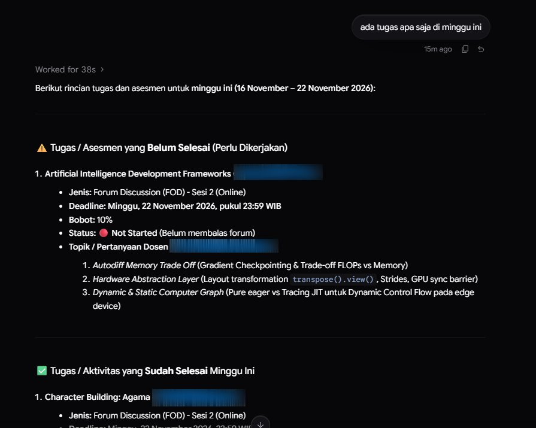

# 🎓 BINUS LMS Assistant & MCP Server

A standalone local web application and **Model Context Protocol (MCP) Server** built with **FastAPI**, **Jinja2**, **vanilla JavaScript**, and **uv** to monitor forum discussions, manage assignment and assessment schedules, access virtual meeting/attendance links, and enable seamless AI assistant automation directly with [BINUS LMS](https://lms.binus.ac.id/lms).

---

## 🚀 Key Features

### 💬 1. Forum Discussion Assistant (`/forum`)



- **Interactive Card-Based Feed**: Every lecturer question/thread is displayed in a structured card with session numbers, lecture topic, lecturer name, and posting date.
- **Reply Status Indicators**:
  - 🟢 **Replied by You**: Displays the submission date and a preview of your submitted answer.
  - 🟠 **Not Replied Yet**: Clearly highlights forums that still require your answer.
- **Direct Answer Submission**: Post your responses directly from each card without opening the LMS web portal manually. The status switches to green (🟢) instantly without page reload (*optimistic UI*).
- **Deep-Link to LMS Portal**: Jump directly to any specific thread on the official BINUS LMS website with a single click.
- **Comment & Reply Drawer**: Browse in-depth discussion threads and examine responses from classmates and lecturers.
- **Quick Filters**: Filter by academic period, course/subject (including LEC & LAB components), specific session, or toggle *Show Unanswered Only*.

### 📅 2. Schedule & Assessment Dashboard (`/schedule`)



- **Unified Assessment Timeline**: Consolidates all individual assignments, group/team assignments, quizzes, and forum activities into a single clean dashboard.
- **Deadline Tracking & Countdown**: Automatically sorted by nearest deadline, complete with remaining time countdown badges and *urgent* / *overdue* warnings.
- **Submission & Scoring Status**: Monitor submission progress (*Submitted* / *Not Submitted*), grading status (*Scored* / *Not Scored*), and earned scores.
- **Team & Group Details**: Automatically inspects group members, teammates, and team IDs for group tasks.
- **Download Question Documents**: Download assignment briefs, worksheets, and attachments directly via download buttons.
- **Virtual Attendance & Conference Links (Zoom/Teams)**: Automatically detects virtual lecture sessions and attendance links, allowing 1-click joining.
- **Deep-Link to Assessments**: Direct link to the submission page on the LMS portal.

### 🤖 3. Model Context Protocol (MCP) Server

- Provides industry-standard MCP endpoints via **Streamable HTTP** (`/mcp`) and **Stdio** (`--mcp-stdio`).
- Connects directly to AI Assistants (such as Antigravity, Claude Desktop, Cursor, Roo Code, etc.) to fetch academic schedules, analyze forum prompts, draft comprehensive responses, and post replies autonomously.

### ⚡ 4. Smart Auth & High Performance

- **Lightweight Architecture**: Built without heavy JavaScript frontend frameworks (pure HTML5, CSS3, modern Vanilla JS).
- **Multi-threading**: Parallel data fetching powered by `ThreadPoolExecutor` to load courses, sessions, threads, and assessments near-instantly.
- **Persistent Chrome Profile (`.chrome_user_data/`)**: Preserves BINUS SSO login sessions and cookies securely on your local machine.
- **Smart Token Cache (`.auth_cache.json`)**: Tokens are decrypted automatically using the LMS AES key (`%v$4T!9CRqE_[G-=`) and cached locally for blazing-fast startup (< 100ms).

---

## 📁 Project Structure

```text
lms_forum_answer/
├── assets/                   # Screenshots & documentation assets
│   ├── forum-ui-demo.jpg     # Web UI Forum Assistant screenshot
│   ├── schedule-ui-demo.jpg  # Web UI Schedule & Assessment Dashboard screenshot
│   └── mcp-assistant-demo.jpg# AI Assistant MCP query screenshot
├── .chrome_user_data/        # Local Chrome profile (cookies, SSO session)
├── .auth_cache.json          # Decrypted JWT token cache & APIM headers
├── lms_auth.py               # Selenium automation for login & JWT extraction
├── lms_api.py                # Azure APIM HTTP client (courses, sessions, threads, tasks)
├── server.py                 # FastAPI backend server & MCP streamable mount (/mcp)
├── mcp_server.py             # MCPServer definition & 12 tool implementations
├── browser.py                # Selenium Chrome driver configuration helper
├── main.py                   # Application entry point (CLI argument handler & launcher)
├── ecosystem.config.js       # PM2 process manager configuration
├── pyproject.toml            # Project definition & uv dependencies
├── templates/                # Jinja2 HTML templates
│   ├── layouts/
│   │   └── base.html         # Base layout template
│   ├── components/
│   │   ├── header.html       # Navigation header & user profile
│   │   └── sidebar.html      # Sidebar menu (Forum & Schedule)
│   ├── forum.html            # Forum Discussion Assistant page
│   └── schedule.html         # Schedule & Assessment Dashboard page
├── static/                   # Static frontend assets
│   ├── css/
│   │   ├── base.css          # Global CSS (theme, layout, typography)
│   │   ├── forum.css         # Styling for forum page
│   │   └── schedule.css      # Styling for schedule page
│   └── js/
│       ├── common.js         # Common utilities & re-login trigger
│       ├── forum.js          # Forum frontend logic & submit handling
│       └── schedule.js       # Schedule logic, filters, modals & document downloads
└── README.md                 # Project documentation
```

---

## 🛠️ Installation & Setup

### 1. Prerequisites
- [Python](https://www.python.org/) 3.10+
- [uv](https://github.com/astral-sh/uv) (Fast Python package and project manager)
- Google Chrome installed on your machine

### 2. Synchronize Dependencies
Install and synchronize all dependencies with a single command:
```powershell
uv sync
```

### 3. Run the Web Application
Start the application using:
```powershell
uv run python main.py
```
Your default browser will automatically open to:
👉 **`http://127.0.0.1:8000`**

#### 💡 CLI Options:
| Flag | Description |
|---|---|
| *(none)* | Starts the web server and automatically opens the Web UI in your browser. |
| `--no-browser` | Starts the web server without launching a browser window. |
| `--login` | Launches an interactive Chrome session to log in via BINUS SSO. |
| `--mcp-stdio` / `--stdio` | Runs the server in MCP Stdio transport mode for AI clients. |

---

### 4. Running in Background with PM2 (Recommended)
To keep the web server and MCP endpoint running continuously in the background without terminal windows, and auto-start on system boot:

1. **Install PM2 & Windows Startup Utility** (if not already installed):
   ```powershell
   npm install -g pm2
   npm install -g pm2-windows-startup
   pm2-startup install
   ```

2. **Start the Application via PM2**:
   ```powershell
   pm2 start ecosystem.config.js
   ```

3. **Save the Process List for System Boot**:
   ```powershell
   pm2 save
   ```

4. **Useful PM2 Commands**:
   - Check status: `pm2 status`
   - View logs: `pm2 logs lms-forum`
   - Restart server: `pm2 restart lms-forum`
   - Stop server: `pm2 stop lms-forum`

---

### 5. Re-Login (*Token Expiration*)
LMS authentication tokens have a finite lifetime. When your session expires or an authentication error occurs:
- Click the **"🔑 Re-Login"** button on the web navigation header, or
- Run via terminal:
  ```powershell
  uv run python main.py --login
  ```
A Chrome browser window will appear. Complete your BINUS SSO login. The new session tokens will be extracted and cached automatically.

---

## 🌐 Web Navigation & REST API

### Web Pages:
- **`http://127.0.0.1:8000/forum`** — Forum discussion monitoring and answering dashboard.
- **`http://127.0.0.1:8000/schedule`** — Assessment calendar, quizzes, team projects, and virtual class links.

### REST API Endpoints:
| Method | Endpoint | Description |
|---|---|---|
| `GET` | `/api/init` | Retrieves user profile, academic periods, active period, and registered courses. |
| `GET` | `/api/subjects` | Retrieves courses for a specific academic period (`period`, `include_lab`). |
| `GET` | `/api/sessions` | Retrieves lecture sessions for a given `class_id`. |
| `GET` | `/api/posts` | Retrieves lecturer forum threads along with user reply status. |
| `GET` | `/api/comments` | Retrieves student and lecturer replies for a specific forum thread. |
| `POST` | `/api/answer` | Submits an answer/reply to a forum thread via the LMS API. |
| `GET` | `/api/schedule/assessments` | Retrieves all assignments, quizzes, and tasks with deadlines and scores. |
| `GET` | `/api/schedule/team` | Retrieves team/group member details for group assignments. |
| `GET` | `/api/schedule/assessment-documents` | Retrieves question documents and attachments for an assessment. |
| `GET` | `/api/schedule/download-document` | Proxies document downloads directly to the browser. |
| `GET` | `/api/schedule/attendance-link` | Retrieves virtual meeting (Zoom/Teams) and attendance links. |
| `POST` | `/api/relogin` | Triggers an interactive login flow via Chrome. |

---

## 🤖 Model Context Protocol (MCP) Integration

This server implements the **Model Context Protocol (MCP)**, allowing AI Assistants (such as Antigravity, Claude Desktop, Cursor, Roo Code, etc.) to query and interact with your LMS academic data directly.


*Example interaction: An AI assistant (Antigravity) automatically invoking MCP tools to query and summarize pending assignments, upcoming deadlines, and unanswered forum topics.*

### 1. HTTP Transport (Streamable HTTP)
Use this option when the web server or PM2 is already running in the background:
- **URL**: `http://127.0.0.1:8000/mcp`

Configuration example (`claude_desktop_config.json` or equivalent MCP configuration file):
```json
{
  "mcpServers": {
    "binus-lms": {
      "url": "http://127.0.0.1:8000/mcp"
    }
  }
}
```

### 2. Stdio Transport
Use this option when you want your AI client to launch the MCP server process on demand:
```json
{
  "mcpServers": {
    "binus-lms": {
      "command": "uv",
      "args": ["run", "python", "main.py", "--mcp-stdio"]
    }
  }
}
```

---

### 📋 Available MCP Tools:

| Tool | Parameters | Description |
|---|---|---|
| `init_session` | *None* | Retrieves user profile, academic periods, active period, and registered courses. |
| `get_subjects` | `period: str`, `include_lab: bool = False` | Retrieves enrolled courses for a given academic period. |
| `get_sessions` | `class_id: str` | Retrieves lecture sessions and current active session for a course class. |
| `get_posts` | `class_id: str`, `session_id: Optional[str]` | Retrieves lecturer forum threads for a class session, including your reply status. |
| `get_thread_detail` | `class_id: str`, `thread_id: str` | Retrieves the full lecturer question text as clean plain text. |
| `get_comments` | `class_id: str`, `thread_id: str`, `page: int = 1`, `limit: int = 25` | Retrieves replies from classmates and lecturers for a forum thread. |
| `post_answer` | `thread_id: str`, `answer_text: str`, `class_id: Optional[str]`, `session_id: Optional[str]` | Submits your reply to a forum thread directly to BINUS LMS. |
| `get_schedule_assessments` | `period: Optional[str]`, `force_refresh: bool = False` | Retrieves all tasks, quizzes, and assessments with deadlines, scores, and status. |
| `get_schedule_team` | `class_id: str`, `assessment_group_id: Optional[str]`, `force_refresh: bool = False` | Retrieves study group details and teammate lists for team assignments. |
| `get_assessment_documents` | `class_id: str`, `resource_id: str`, `assessment_id: Optional[str]` | Retrieves metadata and download URLs for assessment question documents. |
| `get_attendance_link` | `class_id: str`, `session_id: str`, `resource_id: Optional[str]` | Retrieves virtual meeting (Zoom/Teams) and attendance links for a session. |
| `relogin` | *None* | Triggers an interactive browser window to refresh expired authentication sessions. |

---

## 🔒 Privacy Policy

- **Exclusive Local Storage**: All authentication credentials, Chrome browser session profiles (`.chrome_user_data/`), and session token caches (`.auth_cache.json`) reside strictly on your local machine.
- **No Third-Party Transmission**: No analytics, telemetry, or personal data are collected or transmitted to external servers. The application communicates directly and securely with official BINUS LMS Azure APIM endpoints.
- **Data Responsibility & Distribution**: All responsibilities regarding the management, privacy, security, and any potential dissemination or sharing of your academic data and credentials rest entirely with each individual user. Never commit, publish, or publicly share token caches or session directories (protected by default via `.gitignore`).

---

## 📜 Terms of Use & Disclaimer

1. **Non-Official / Independent Project**: This application is an independent open-source utility developed solely for personal productivity and learning assistance. It is **NOT officially affiliated with, endorsed by, sponsored by, or maintained by BINUS University**. All trademarks, institution names, and logos belong to their respective owners.
2. **Strict API Authorization Compliance**: This tool communicates exclusively with authorized, standard API endpoints strictly within the scope of the individual user's authenticated credentials (*authorization scope*). The software **does not bypass security mechanisms, perform privilege escalation, exploit vulnerabilities, or exceed permissions** granted to the authenticated user account.
3. **Prohibition of Misuse**: This tool is designed strictly to facilitate personal task management and study productivity. It must not be misused for academic dishonesty, unauthorized mass automation, forum spamming, system degradation, or any activity that violates university rules, academic codes of conduct, or applicable laws.
4. **Limitation of Liability**: Use of this software is entirely at your own discretion and risk (*as-is*). The author(s) and contributor(s) assume no liability or responsibility for any consequences, academic disciplinary actions, or damages arising from the use or misuse of this tool.
